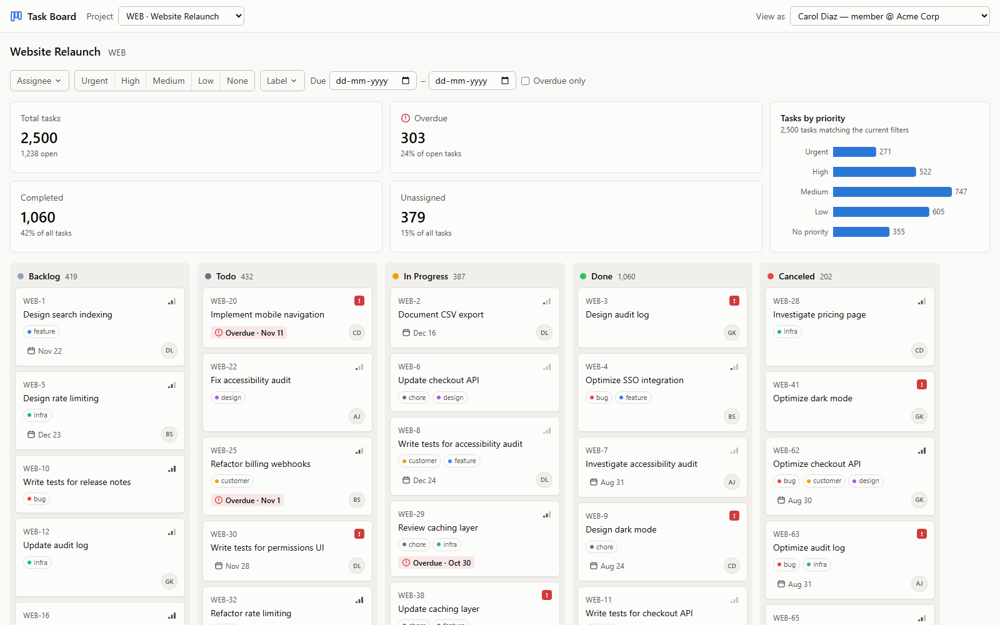

# Task Board: Multi-tenant Project Management (Take-Home)

A simplified Linear/Jira-style platform built for the Compliance Foundry Senior Full-Stack assessment. It has three parts:

- A PostgreSQL data model.
- A Node.js GraphQL API.
- A React + TypeScript task board.

The design documents, AI critique and RFC sit alongside the code.

> **Status:** Parts 1 and 2 are done (data model, docs, critique, GraphQL API, task board). Part 3 (RFC) is in progress.



## Quick start

Requires **Node.js ≥ 22.12** (developed on 24.12). No database install and no Docker: PostgreSQL runs embedded via [PGlite](docs/tech-stack-choice.md#3-database-runtime-postgresql-via-pglite-not-docker).

```bash
npm install
npm run setup   # create the embedded database, apply migrations, load demo data
npm run dev     # API on :4000 + task board on http://localhost:5173 (open this)
npm run check   # typecheck, lint, format, generated-types check, tests
```

To use a real PostgreSQL server instead, copy `api/.env.example` to `api/.env` and set `DATABASE_URL`.

### Inspecting the database (DBeaver, psql, …)

PGlite runs inside a Node process, so there's no always-on server to connect to. `npm run db:serve` provides one: it opens the dev database (`api/.pglite`), applies pending migrations, and serves it until you press Ctrl+C.

| Setting             | Value                                                                         |
| ------------------- | ----------------------------------------------------------------------------- |
| Host                | `127.0.0.1`                                                                   |
| Port                | `54320` (`PGLITE_PORT` to change it)                                          |
| Database            | `postgres`                                                                    |
| Username / password | `postgres` / `postgres`. Not checked: the server only listens on this machine |

In DBeaver, choose **New Database Connection → PostgreSQL** and enter the values above. Keep in mind:

- **Leave auto-commit on** (DBeaver's default). All tool connections share PGlite's single Postgres session, so a manual-commit transaction or a session-level `SET` would affect every DBeaver tab.
- **You're the superuser, which bypasses row-level security.** To see what a given user can see, run this as one script:
  `BEGIN; SET LOCAL ROLE app_user; SELECT set_config('app.user_id', '<user id>', true); SELECT * FROM tasks; ROLLBACK;`
- **Other `db:*` commands refuse to run while `db:serve` holds the database.** PGlite has no built-in guard against two processes writing the same files, so a lock file (`api/.pglite.lock`) provides one.
- **If DBeaver reports an SSL error**, set SSL mode to `disable` in the connection's SSL tab.

## Repository layout

```
api/                 Node.js GraphQL API (TypeScript)
  db/migrations/     Hand-written SQL migrations, the schema's source of truth
  src/graphql/       Schema (SDL), resolvers, DataLoaders, transaction plugin, scalars
  src/repositories/  All SQL: filters, keyset pagination, board columns, summary, moveTask
  src/auth/          Access tokens (JWT via jose)
  src/db/            Connection pool, embedded Postgres, migrator, seed data, generated types
  src/scripts/       CLI scripts: db:migrate, db:seed, db:reset, db:serve, db:codegen
  test/              Integration tests against real (embedded) Postgres
web/                 React task board (Vite, Apollo Client, Tailwind, dnd-kit, Recharts)
  src/features/board/  TaskBoard (container), columns, cards, filters, summary, chart
  src/apollo/        Client + normalized cache (per-column pagination merge)
docs/                Design docs, critique, RFC, tech stack rationale
```

## Documents

- [Tech stack choice](docs/tech-stack-choice.md): what every tool is, why we chose it, and what we turned down.
- [Part 1: System design](docs/part1/README.md): data model (GraphQL + SQL), technical documentation, critique.
- [Part 2: Implementation](docs/part2/README.md): the GraphQL API and the task board, with design explanations.

## Assumptions

- "Organization" and "workspace" are the same tenant concept; the code and docs say "organization".
- Authentication is out of scope. Seeded users get signed development tokens, and authorization is fully enforced.
