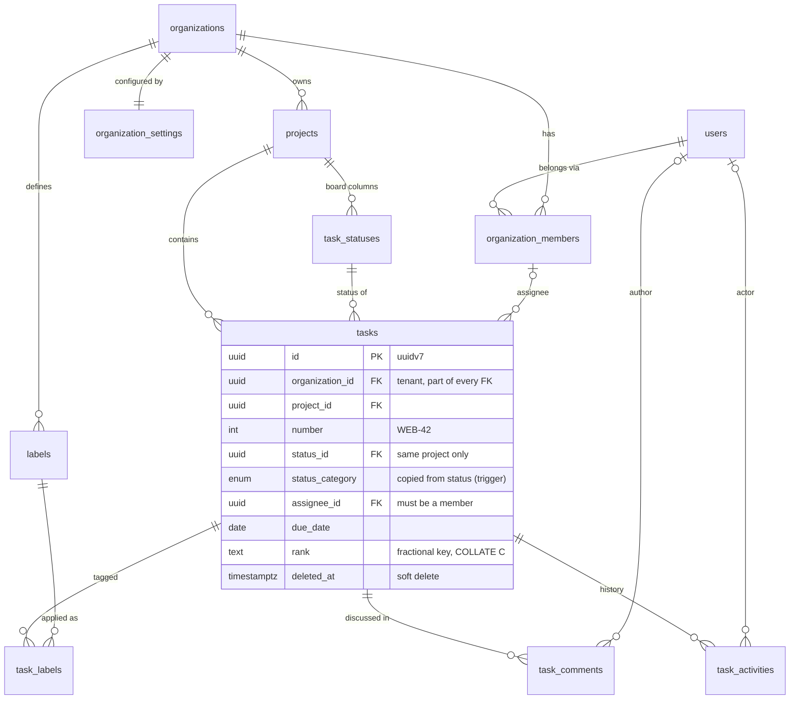

# Technical Design: Data Model (Schema v1)

|                |                                                                                                                                                                                                                                                                                                                    |
| -------------- | ------------------------------------------------------------------------------------------------------------------------------------------------------------------------------------------------------------------------------------------------------------------------------------------------------------------ |
| **Covers**     | Task 1.2: data model rationale, query patterns, indexing and performance, multi-tenancy, migration strategy                                                                                                                                                                                                        |
| **Built from** | Schema v1 (git tag `schema-v1`): SQL in [`api/db/migrations/0001–0005`](../../api/db/migrations/), GraphQL design in [`schema.graphql`](schema.graphql)                                                                                                                                                            |
| **Evidence**   | 22 schema tests ([`schema.test.ts`](../../api/test/schema.test.ts)). Every query below was run with `EXPLAIN ANALYZE` as the API role, with row-level security on, against 24,000 tasks in two organizations. PGlite runs the real Postgres 18 planner: plan shapes are valid, timings are not production numbers. |

## 1. Data model and entity relationships



The tables fall into three groups: **tenancy** (who belongs where, with which role), **work** (projects, statuses, labels, tasks), and **collaboration and history** (comments and an append-only activity log).

| Decision                                                                                                            | Why                                                                                                                                                                                                                                                         | Cost we accept                                                                       |
| ------------------------------------------------------------------------------------------------------------------- | ----------------------------------------------------------------------------------------------------------------------------------------------------------------------------------------------------------------------------------------------------------- | ------------------------------------------------------------------------------------ |
| **Users ↔ organizations is many-to-many**; the role lives on `organization_members`                                 | One person can work in several tenants with one login. For example, the Compliance Foundry group runs Compliance Foundry, Comperis Cybersecurity and Fixpliance AI as separate organizations, and the same person can be admin in one and viewer in another | Each request's permission check is a membership lookup, served from a covering index |
| **`organization_id` on every tenant row; foreign keys include it**, e.g. `(organization_id, project_id) → projects` | A task physically cannot reference another tenant's project, status, assignee or label. Row-level security filters each table without joins                                                                                                                 | One extra column, plus an extra unique index on each parent table                    |
| **Custom statuses per project, each mapped to a fixed category** (`backlog … canceled`)                             | Teams name columns freely; "open", "overdue" and "completed" logic uses the category, never the name                                                                                                                                                        | Changing a status's category rewrites its tasks                                      |
| **`tasks.status_category` is a copy maintained by triggers**; a CHECK ties `completed_at` to it                     | The hottest filter ("open") becomes a partial index on one table                                                                                                                                                                                            | Trigger upkeep. A CHECK constraint guarantees the copy can't disagree                |
| **One assignee per task** (the Linear/Jira model)                                                                   | Counts per assignee stay unambiguous, and ownership is clear                                                                                                                                                                                                | Multiple assignees would need a link table (§5 shows the migration)                  |
| **History is written by triggers**, append-only, with snapshots of status and label names                           | Complete no matter which code path writes. The actor comes from the request context, and old names survive renames                                                                                                                                          | More writes per edit; the logic lives in SQL, documented and tested                  |

**Smaller choices:**

- **Labels** are organization-wide, so one "bug" label works across projects.
- **Settings** are typed columns; the time zone defines when a task is overdue.
- **Keys** are UUIDv7: time-ordered, so index-friendly, and safe to expose.
- **Readable numbers** (`WEB-42`) come from a per-project counter row, so inserts within one project take turns on its lock.
- **Card order** is a sortable text rank, so a drag rewrites one row.
- **Deletion:** tasks and comments are soft-deleted, projects are archived, and only whole organizations are hard-deleted (one cascade).

## 2. Query patterns

Resolvers run inside `withUserContext()` (role `app_user`, with `app.user_id` set). Row-level security then adds `organization_id = ANY(<caller's organizations>)` to every table read, computed **once per query** (an `InitPlan`), not per row.

### 2.1 "All overdue tasks assigned to me, across projects": `myTasks(filter: { overdue: true })`

```sql
SELECT t.id, p.key || '-' || t.number AS identifier, t.title, t.due_date, t.priority
  FROM tasks t
  JOIN projects p              ON p.id = t.project_id
  JOIN organization_settings s ON s.organization_id = t.organization_id
 WHERE t.assignee_id = $1                                  -- the viewer
   AND t.deleted_at IS NULL                                -- ┐ repeats the partial index's
   AND t.status_category NOT IN ('completed', 'canceled')  -- ┘ predicate, word for word
   AND t.due_date < (now() AT TIME ZONE s.timezone)::date  -- "today" in each organization's zone
 ORDER BY t.due_date, t.id
 LIMIT 50;
```

**Verified plan:** an index scan on `tasks_open_assigned_due_idx` visits only the viewer's open, assigned tasks (172 across both organizations), already in due-date order. "Overdue" depends on each organization's "today", so it can't be in an index predicate; it filters that small slice.

### 2.2 One board column, one page: `TaskStatus.tasks(first: 50, after: $cursor)`

```sql
SELECT t.id, t.number, t.title, t.priority, t.assignee_id, t.due_date, t.rank
  FROM tasks t
 WHERE t.project_id = $1 AND t.status_id = $2 AND t.deleted_at IS NULL
   AND (t.rank, t.id) > ($3, $4)          -- cursor = (rank, id) of the last card already shown
 ORDER BY t.rank, t.id
 LIMIT 51;                                -- one extra row → hasNextPage, without COUNT(*)
```

**Verified plan:** the row comparison is part of the index lookup on `tasks_board_idx`. A page 100 cards deep into a 4,000-card column read **11 buffer pages**. There's no OFFSET, so every page costs about the same, and cards added mid-scroll don't shift the next page.

Other filters are checked during the same index scan. A label filter becomes a semi-join, and the planner picks its direction from label statistics: a rare label read 20 pages, a common one 269. The worst case is a label that's common overall but absent from this column. The planner walks the whole column then (4,000 index probes), so the column size bounds it.

### 2.3 Summary for the panel and charts: `Project.taskSummary`

```sql
SELECT GROUPING(t.status_id, t.priority, t.assignee_id) AS grouping_set,  -- which breakdown a row belongs to
       t.status_id, t.priority, t.assignee_id,
       count(*) AS tasks,
       count(*) FILTER (WHERE t.status_category NOT IN ('completed', 'canceled')
                          AND t.due_date < $2) AS overdue       -- $2 = today in the organization's zone
  FROM tasks t
 WHERE t.project_id = $1 AND t.deleted_at IS NULL
 GROUP BY GROUPING SETS ((), (t.status_id), (t.priority), (t.assignee_id));
```

**Verified plan:** one `MixedAggregate` builds all four breakdowns in **one pass**. It used a sequential scan because this project held 83% of all rows; among 500 organizations a project is a tiny slice, and the `project_id`-leading indexes apply. Cost grows linearly with project size (§3).

### 2.4 Related objects without N+1

`Task.assignee`, `Task.labels` and `Task.status` are resolved through **per-request DataLoaders**. Each one collects the IDs for the whole page and runs one `WHERE id = ANY($1)` (or `task_id = ANY($1)`). A 50-card page therefore costs 1 + 3 queries, however many cards it holds. Loaders are created per request, so their caches can never serve one user's or tenant's rows to another. Timelines page the same way as §2.2.

## 3. Indexing strategy and performance

| Index                                                                                  | Serves                                                                 | Design note                                                                                          |
| -------------------------------------------------------------------------------------- | ---------------------------------------------------------------------- | ---------------------------------------------------------------------------------------------------- |
| `tasks_board_idx (project_id, status_id, rank, id) WHERE deleted_at IS NULL`           | Board columns, keyset pages, per-status counts                         | Equality columns first, then the exact `ORDER BY`, so `LIMIT` stops early. Deleted rows are excluded |
| `tasks_open_assigned_due_idx (assignee_id, due_date) WHERE live AND open AND assigned` | "My tasks", "my overdue"                                               | Covers only open work, so it stays small as history grows                                            |
| `tasks_assignee_idx (assignee_id) WHERE assigned`                                      | All of a user's tasks; the `SET NULL` cleanup when a member is removed | Prevents a full table scan when a member leaves                                                      |
| `organization_members_user_idx (user_id, organization_id) INCLUDE (role)`              | The membership lookup behind row-level security, on every request      | Covering, so it's answered from the index alone                                                      |

**Principles:**

- Indexes mirror access paths: equality columns first, then sort columns.
- Partial indexes keep hot indexes proportional to _live_ work, not all history.
- Keyset pagination everywhere: constant cost per page, stable while data changes.

**Costs and limits we accept, and what to watch first:**

1. **Writes on `tasks` are amplified:** there are 6 indexes and 5 row triggers, up to 3 of which fire on any one write. A card drag changes `rank`, which is indexed, so Postgres can't use a cheap in-place ("HOT") update and writes a new entry into _all six_ indexes. That's fine at human drag-and-drop rates, and it's the first metric to watch as boards grow.
2. **Inserts take turns per project:** creating a task locks its project's counter row until commit. Insert transactions must stay short.
3. **Bulk paths pay per-row trigger costs** (counter, status sync, history): seeding 24,000 tasks took about 18 s on PGlite, so imports should be batched and run off-peak.
4. **`task_activities` grows fastest** (one row per changed field). It's append-only, which makes it the natural first candidate for monthly partitioning or archival.
5. **The summary costs O(project size) per request.** One pass is cheap at 2,000–20,000 tasks. Beyond that, cache it or keep counters (Part 3 RFC).
6. **Row-level security cost:** read policies add one `InitPlan` per query (verified). Write policies call `has_organization_role()` once per row: negligible for single-row mutations, worth noting for bulk updates.

## 4. Multi-tenancy isolation

We use a **shared schema with `organization_id` and row-level security**. A database or schema per tenant isolates more strongly, but at 500+ organizations it multiplies migrations, catalogs and connection pools by 500. With a shared schema, isolation is still **enforced by Postgres**, not only by application code. It comes in layers, so no single bug exposes another tenant:

1. **API authorization:** resolvers check membership and role. Anything outside the caller's organizations returns `NOT_FOUND`, never confirming that it exists.
2. **Request context:** each request is one transaction that starts with `SET LOCAL ROLE app_user` and `set_config('app.user_id', …, true)`.
   - Both reset at commit, so a pooled connection never carries one request's identity into the next. That's also what makes this compatible with PgBouncer's transaction pooling.
   - With no user set, every policy matches nothing. The `nullif` guard keeps this fail-closed, and tests prove it.
3. **Row-level security on every table** (a test fails if a table lacks it): reads require membership, and writes require the role thresholds in the permission matrix in `0005`.
4. **Column-level grants:** `organization_id`, `project_id`, authorship and trigger-owned columns are never writable by the API, so no query can move a task to another tenant.
5. **Composite foreign keys:** cross-tenant references are impossible even for privileged code.

**The privileged surface is small and reviewed:** migrations, seeds, and 12 narrowly scoped `SECURITY DEFINER` functions. Each pins `search_path = ''`, and `EXECUTE` is granted explicitly.

**Noisy neighbours** share tables, but every hot access path starts with a project or an assignee. Having `organization_id` in every row and composite key leaves a path to partition or shard by organization later (Citus would also need `(organization_id, id)` primary keys).

## 5. Migration strategy

**Mechanics:**

- Numbered, forward-only `.sql` files are the single source of truth.
- Kysely's `Migrator` applies them in one transaction per batch, with a tracking table and an advisory lock.
- CI fails if the generated TypeScript types are stale (`db:codegen --verify`).
- A committed migration is never edited: schema v1 is tagged, and the fixes after the critique ship as `0006+`.
- Migrations run _before_ the new application version rolls out, so every change must work with the old code still running.

**Zero-downtime rules (expand → migrate → contract):**

| Change                        | Safe recipe                                                                                                                                      |
| ----------------------------- | ------------------------------------------------------------------------------------------------------------------------------------------------ |
| Add a column                  | Nullable, or with a constant `DEFAULT`, which is a metadata-only change since PG 11                                                              |
| Add `NOT NULL` / `CHECK` / FK | Add it `NOT VALID`, backfill, then `VALIDATE CONSTRAINT`, which doesn't block writes while it scans                                              |
| Add an index                  | `CREATE INDEX CONCURRENTLY`. It can't run inside a transaction, so it runs in a separate migrator pass with Kysely's `disableTransactions: true` |
| Rename or remove a column     | Expand/contract: add the new column, dual-write, backfill, switch reads, drop the old column in a _later_ release                                |
| Add an enum value             | `ALTER TYPE … ADD VALUE` in its own migration, released before any code that uses the value                                                      |
| Large backfill                | A batched, idempotent data job (e.g. 5,000 rows per transaction), separate from schema DDL                                                       |
| Any DDL                       | `SET lock_timeout` first, so the migration fails fast instead of queueing behind a long transaction and stalling traffic                         |

**Worked example: one assignee → several assignees.**

1. **Expand:** add `task_assignees` with composite foreign keys and row-level security. A trigger mirrors `tasks.assignee_id` into it, and existing assignees are backfilled in batches.
2. **Migrate:** add `Task.assignees` to the API and mark `Task.assignee` `@deprecated`; it still works. Then switch reads, writes and the "my tasks" index to the new table.
3. **Contract:** once usage metrics show no client reads `assignee`, a later migration drops `tasks.assignee_id`.

**GraphQL evolves the same way:** add freely, deprecate before removing. **Rollback means rolling forward:** a bad migration is fixed by a new one, and thanks to the expand phase the previous application version keeps working if a deploy is reverted.
