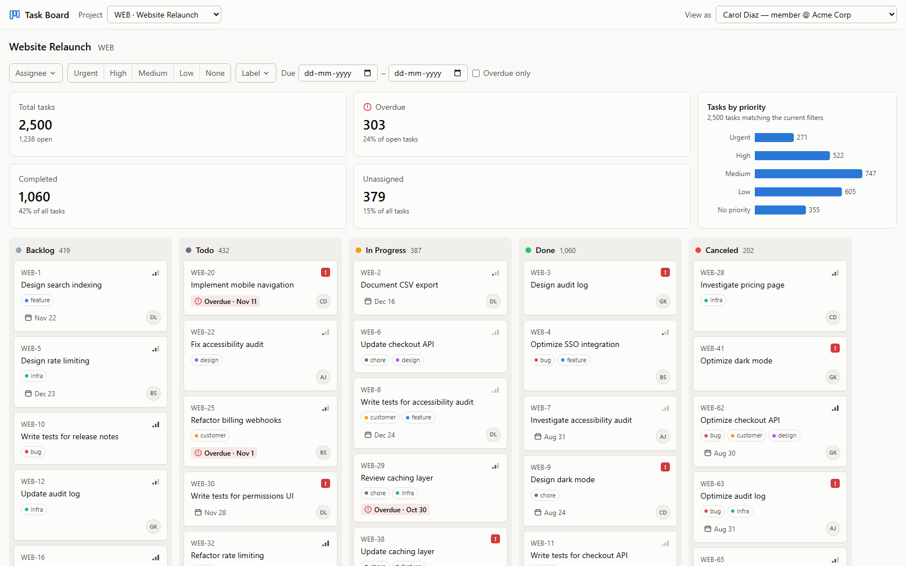
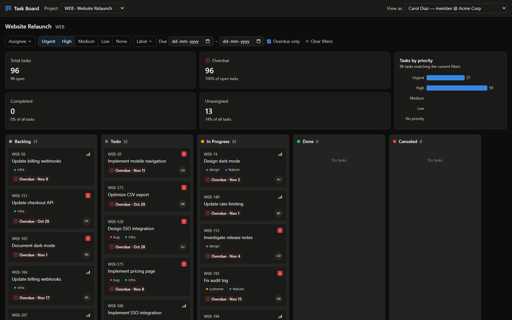

# Part 2: Full-Stack Implementation

## Task 2.1: Backend GraphQL API

| Deliverable                       | Where                                                                                                                                                                                                                     |
| --------------------------------- | ------------------------------------------------------------------------------------------------------------------------------------------------------------------------------------------------------------------------- |
| GraphQL schema (type definitions) | [`api/src/graphql/schema.graphql`](../../api/src/graphql/schema.graphql)                                                                                                                                                  |
| Resolver implementation           | [`api/src/graphql/resolvers.ts`](../../api/src/graphql/resolvers.ts), with SQL in [`api/src/repositories/tasks.ts`](../../api/src/repositories/tasks.ts) and batching in [`loaders.ts`](../../api/src/graphql/loaders.ts) |
| Tests                             | [`api/test/graphql.test.ts`](../../api/test/graphql.test.ts) (every result checked against SQL ground truth) and [`graphql-contract.test.ts`](../../api/test/graphql-contract.test.ts)                                    |

Run it with `npm run setup` then `npm run dev`. GraphiQL is at http://localhost:4000/graphql, and http://localhost:4000/dev/users gives a token for every seeded user.

### Design decisions

**The contract comes first.** The SDL is a strict subset of the Part 1 design (a test enforces it), and GraphQL Code Generator types every resolver against it, so drift fails the build.

**Authorization is enforced by Postgres, not by memory.** Each GraphQL operation runs in one transaction as `app_user`, with the caller's id set, so row-level security filters every query. Resolvers get only that transaction; no unscoped database handle exists. Other tenants' ids return `null` or `NOT_FOUND`, never "forbidden", and database messages are masked.

**The query count is constant.** Per-request DataLoaders batch every relation. All board columns page in one `LATERAL` query, and `identifier` and `isOverdue` are computed in SQL. A test proves a board load issues the same number of queries for 5 or 50 cards per column. The summary is one `GROUPING SETS` pass.

**Pagination is keyset-based.** Cursors encode `(sort value, id)`, never timestamps, so JavaScript's millisecond precision can't skip rows. Sorts use index-friendly keys, with undated tasks last. `first` is capped at 100 and query depth at 10.

**`moveTask` is safe under concurrency.** The server computes a fractional rank between the neighbours while holding a per-column advisory lock, so concurrent drops can't produce the same key. A failed mutation rolls back entirely.

**Trade-off:** a transaction holds its connection for the whole operation, so resolvers may only wait on the database. The summary still scans the project on every request, which Part 3 addresses.

## Task 2.2: Frontend Task Board

| Deliverable                         | Where                                                                                                                                                                                      |
| ----------------------------------- | ------------------------------------------------------------------------------------------------------------------------------------------------------------------------------------------ |
| React component (TypeScript, hooks) | [`web/src/features/board/TaskBoard.tsx`](../../web/src/features/board/TaskBoard.tsx) and its children in the same folder                                                                   |
| Tests                               | Unit tests for filters and drag-and-drop maths, a real-cache test of the optimistic move, and component tests for every state ([`web/src/**/*.test.ts(x)`](../../web/src/features/board/)) |

Run `npm run dev`, then open http://localhost:5173. Pick a project and a "view as" user in the header.

| Light, unfiltered                              | Dark, filtered (urgent + high, overdue only)                   |
| ---------------------------------------------- | -------------------------------------------------------------- |
|  |  |

### State management and component architecture

**One container, presentational children.** `TaskBoard` owns the filters, two queries (`Board`: columns with their first page; `BoardSummary`: counts and chart data) and the move action. `FilterBar`, `SummaryPanel`, `Board`, `BoardColumn` and `TaskCard` receive props and raise callbacks. Their only state is local UI state, such as an open dropdown, a dragged card or a "load more" spinner.

**Each kind of state has one home, and there's no global store:**

- **Server data** lives in Apollo's normalised cache: each task and column is stored once by id. A column's pages, whether from the board query or that column's "load more" (`taskStatus(id)`), merge into one list.
- **Project and filters** live in the URL, read through `useSyncExternalStore`. Links are shareable, and Back undoes a filter.
- **The session** ("view as") is React context. Switching user resets the Apollo cache, so one user's data never shows for another.

**Moves never refetch the board.** A drop updates the card optimistically and edits only the two affected cached lists. It adds the card only to filtered views that contained it, then refetches just the small summary. If the server refuses, Apollo discards the optimistic layer and the card snaps back.

**Every state is handled:**

- **First load:** a skeleton.
- **Filter changes:** the previous board stays on screen, dimmed.
- **Errors:** a retryable error state.
- **Empty:** "no tasks yet" is told apart from "no matches", which offers Clear filters.
- **Viewers:** a read-only board.

**Accessibility and performance:**

- **Accessibility:** drag-and-drop works from the keyboard, with screen-reader announcements. The chart has a table equivalent, and overdue is never shown by colour alone.
- **Colours:** checked with a palette validator in light and dark mode.
- **Performance:** the chart is code-split, which cuts initial JavaScript from 892 kB to 488 kB.
